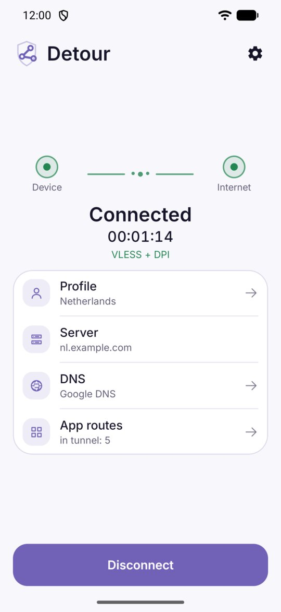
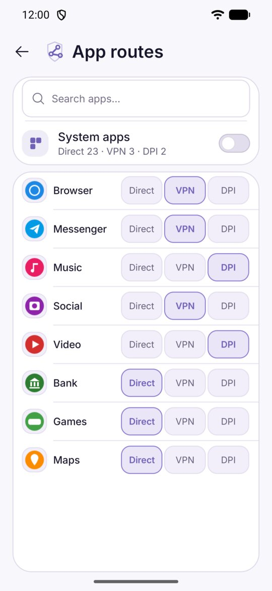
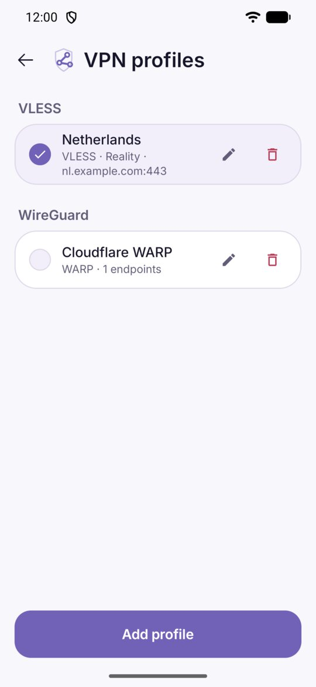
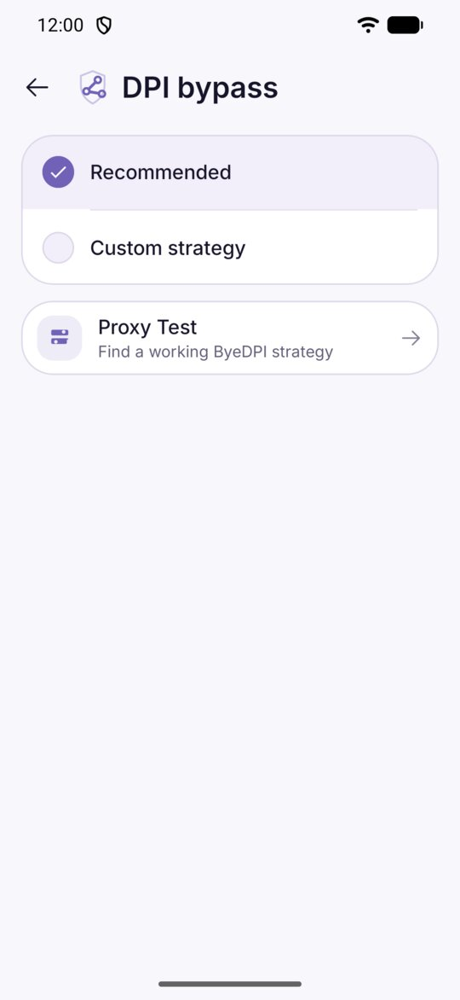

  <a href="README.md">Русский</a> · <strong>English</strong>

# Detour

An Android app that lets you pick how each app reaches the internet: directly, through a VPN, or through DPI bypass.

  
  
  
  

## Why

A regular VPN sends the whole phone through one server. Banking apps complain about a foreign IP, and everything else gets slower than it needs to be. With Detour you decide per app:

- **Banking, shopping, maps** go **direct**, as if the VPN were off.
- **YouTube** goes through **DPI** bypass: it needs no server, and the traffic stays in your country.
- **Instagram or the browser** go through the **VPN**.

All of this runs at the same time and starts with one button.

## What you need

Detour is just the app. **It does not include any servers.** For the VPN route you need your own access, one of:

- a `vless://` key (VLESS Reality) or a subscription URL from your VPN provider;
- a WARP or AmneziaWG file (Clash/Mihomo YAML, or a `.conf` with AmneziaWG parameters);
- an Amnezia `vpn://` key.

If you only need DPI bypass (for example, for YouTube), you need none of this: DPI works without a server.

## Getting started

1. Download the APK from the [latest release](https://github.com/arttvad9r/detour/releases/latest) and install it.
2. **Settings → VPN profiles → Add profile**: paste a key or subscription, or pick a file. Skip this step if you only need DPI.
3. **App routes**: set VPN or DPI for the apps that need it. Everything else stays direct.
4. Tap **Connect** and let Android create the VPN connection.

More details, including DPI tuning tips: [guide](docs/getting-started.en.md).

To get updates automatically, add `https://github.com/arttvad9r/detour` to [Obtainium](https://obtainium.imranr.dev/).

## Also

- Subscriptions: server list, search, ping test.
- Finding a DPI bypass strategy that works with your ISP (Proxy Test).
- DNS: Cloudflare, Google, AdGuard, a custom address or DoH.
- Quick Settings tile, connect on launch.
- Move all settings to another phone (export/import).
- Light and dark themes plus a few color themes.

## FAQ

**Can I use it together with another VPN (Tailscale, a work VPN)?**
No. Android allows only one VPN at a time, and Detour takes that slot.

**Why won't it install?**
Detour needs Android 10 or newer and a 64-bit (arm64) phone. Old 32-bit phones are not supported.

**Google Play Protect shows a warning.**
Detour is not distributed through Google Play, so Play Protect does not know it. Download the APK only from this repository's [releases page](https://github.com/arttvad9r/detour/releases). Each APK comes with a `.sha256` file you can use to check that it was not tampered with.

**What does Detour know about me?**
It sends nothing: no analytics, no crash reports, no account. Keys and settings stay on the phone, encrypted. Details: [privacy policy](PRIVACY.md).

**YouTube is still slow through DPI.**
DPI bypass depends on your ISP. Open **Settings → DPI bypass → Proxy Test**, find a strategy that works for you and apply it.

## For developers

Kotlin and Jetpack Compose, with the tunnel on Android `VpnService`. VPN traffic is handled by an embedded [Mihomo](https://github.com/MetaCubeX/mihomo), DPI bypass by [ByeDPI](https://github.com/hufrea/byedpi). Both are built from source at pinned versions.

[Architecture](docs/architecture.md) · [Build and tests](docs/testing.md) · [Component versions](docs/pins.md) · [Releasing](docs/releasing.md) · [Contributing](CONTRIBUTING.md) · [Security](SECURITY.md) · [Changelog](CHANGELOG.md)

Detour code is licensed under [MIT](LICENSE). Embedded components keep their own licenses, listed in [THIRD_PARTY_NOTICES.md](THIRD_PARTY_NOTICES.md).
