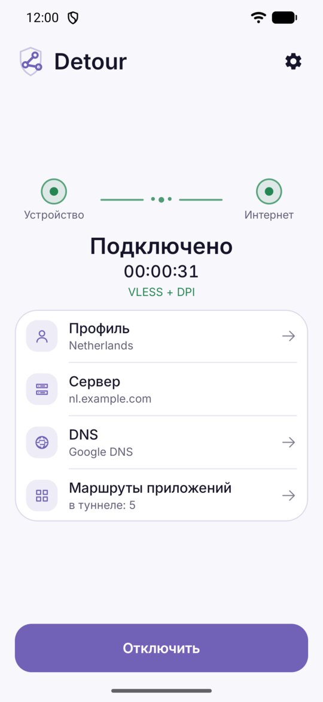
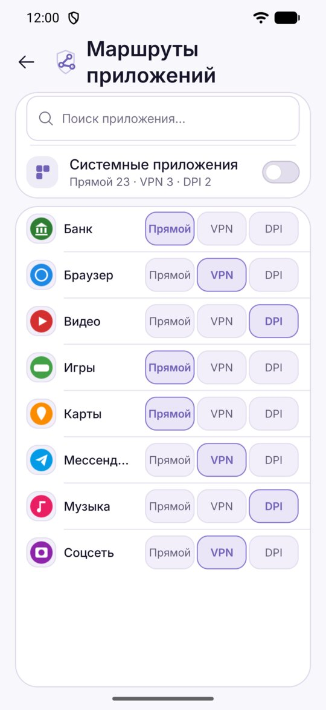
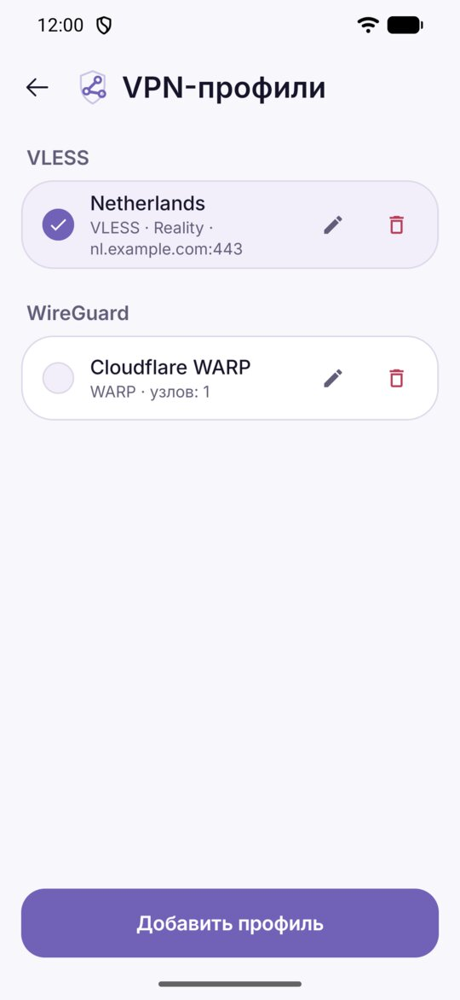
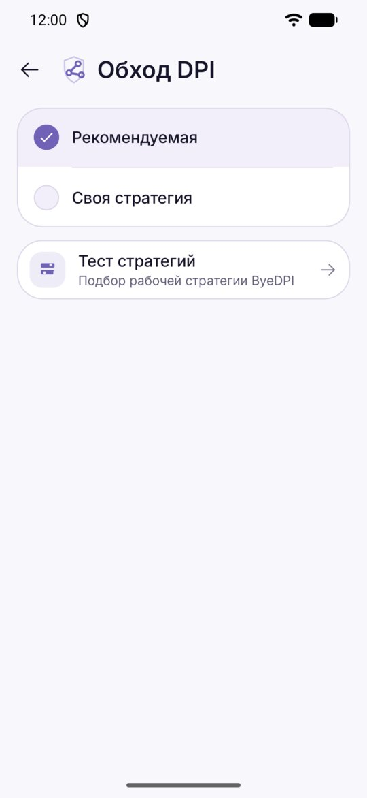

  <strong>Русский</strong> · <a href="README.md">English</a>

# Detour

Приложение для Android, в котором каждому приложению можно выбрать свой путь в интернет: напрямую, через VPN или через обход блокировок (DPI).

  
  
  
  

## Зачем это нужно

Обычный VPN пускает через себя весь телефон. Из-за этого банки и госуслуги ругаются на иностранный IP, а всё остальное работает медленнее, чем могло бы. В Detour вы решаете сами, что куда идёт:

- **Банк, маркетплейсы, карты** работают **напрямую**, как будто VPN выключен.
- **YouTube** идёт через **DPI**: это обход замедления без всякого сервера, трафик не уходит за границу.
- **Instagram или браузер** идут через **VPN**.

Всё это работает одновременно, и включается одной кнопкой.

## Что понадобится

Detour — это только приложение, **серверов в нём нет**. Для режима VPN нужен свой доступ, один из вариантов:

- ключ `vless://` (VLESS Reality) или ссылка на подписку от вашего VPN-провайдера;
- файл WARP или AmneziaWG (YAML для Clash/Mihomo или `.conf` с параметрами AmneziaWG);
- ключ Amnezia `vpn://`.

Если нужен только обход DPI (например, для YouTube), ничего этого не нужно: DPI работает без сервера.

## Как начать

1. Скачайте APK из [последнего релиза](https://github.com/arttvad9r/detour/releases/latest) и установите.
2. **Настройки → VPN-профили → Добавить профиль**: вставьте ключ, подписку или выберите файл. Если нужен только DPI, этот шаг пропустите.
3. **Маршруты приложений**: выберите для нужных приложений VPN или DPI. Всё, что не трогали, остаётся напрямую.
4. Нажмите **«Подключить»** и разрешите Android создать VPN-подключение.

Подробнее, с советами по настройке DPI: [инструкция](docs/getting-started.md).

Чтобы получать обновления автоматически, добавьте ссылку `https://github.com/arttvad9r/detour` в [Obtainium](https://obtainium.imranr.dev/).

## Что ещё умеет

- Подписки: список серверов, поиск, проверка пинга.
- Подбор стратегии обхода DPI под вашего провайдера («Тест стратегий»).
- DNS: Cloudflare, Google, AdGuard, свой адрес или DoH.
- Плитка в шторке уведомлений, подключение при запуске.
- Перенос всех настроек на другой телефон (экспорт/импорт).
- Светлая и тёмная темы и несколько цветовых.

## Частые вопросы

**Можно включить вместе с другим VPN (Tailscale, корпоративным)?**
Нет. Android разрешает только один VPN за раз, и Detour занимает это место.

**Почему приложение не ставится?**
Нужен Android 10 или новее и 64-битный телефон (arm64). На старых 32-битных телефонах Detour не работает.

**Google Play Protect предупреждает об опасности.**
Detour распространяется не через Google Play, поэтому Play Protect его не знает. Скачивайте APK только со [страницы релизов](https://github.com/arttvad9r/detour/releases) этого репозитория. Рядом лежит файл `.sha256`, по нему можно проверить, что APK не подменили.

**Что Detour знает обо мне?**
Ничего не отправляет: ни аналитики, ни отчётов об ошибках, аккаунт не нужен. Ключи и настройки хранятся только на телефоне в зашифрованном виде. Подробнее: [политика приватности](PRIVACY.md).

**YouTube всё равно тормозит через DPI.**
Обход DPI зависит от провайдера. Откройте **Настройки → Обход DPI → Тест стратегий**, найдите стратегию, которая работает у вас, и примените её.

## Для разработчиков

Kotlin и Jetpack Compose, туннель на Android `VpnService`. VPN-трафик обрабатывает встроенный [Mihomo](https://github.com/MetaCubeX/mihomo), обход DPI — [ByeDPI](https://github.com/hufrea/byedpi). Оба собираются из исходников с зафиксированными версиями.

[Архитектура](docs/architecture.md) · [Сборка и тесты](docs/testing.md) · [Версии компонентов](docs/pins.md) · [Релизы](docs/releasing.md) · [Участие](CONTRIBUTING.md) · [Безопасность](SECURITY.md) · [Изменения](CHANGELOG.md)

Код Detour распространяется по лицензии [MIT](LICENSE). У встроенных компонентов свои лицензии, они перечислены в [THIRD_PARTY_NOTICES.md](THIRD_PARTY_NOTICES.md).
